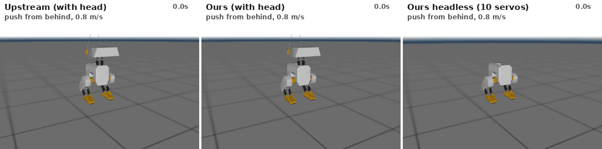
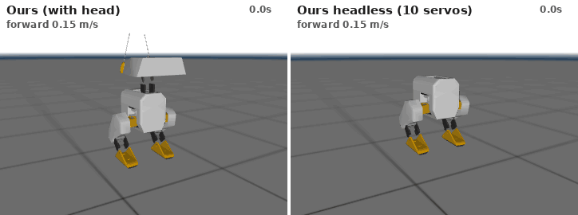

# BipedRL: sim-to-real RL locomotion for the Open Duck Mini v2

Reinforcement-learning locomotion for a small, self-built bipedal robot, the
[Open Duck Mini v2](https://github.com/apirrone/Open_Duck_Mini) (14 Feetech STS3215 servos, ~2.1 kg, ~42 cm).
The project covers GPU-parallel training in MuJoCo MJX, cross-simulator validation, and a single
controller runtime shared by simulation and the real robot.

<p align="center"></p>

**What's here**

- **Independent re-implementation of the Open Duck training stack** on the same GPU libraries
  upstream uses (MuJoCo MJX + Brax PPO + MuJoCo Playground wrappers): about 93k env steps/s on one
  RTX 4070 SUPER, so a 150M-step walking policy trains in about 33 min.
- **One controller contract for every backend:** observation, action and reward code is
  array-library generic. The GPU env (JAX), the CPU env (numpy) and the hardware runtime run *the
  same functions*, with parity tests between them. Upstream's training env and robot runtime are
  separate code and have drifted apart.
- **Audit of the upstream training setup:** nine findings, eight fixed, e.g. randomizations that
  were silently inert, episodes that never fully reset, and resets that start the feet inside the
  floor ([details](docs/platform_selection.md#gaps-found-while-integrating-upstream-relevant-to-sim-to-real)).
- **Automated validation:** every MJX-trained policy is exported to ONNX (checked against Brax
  inference to about 1e-7), then evaluated in CPU MuJoCo and in the deployment loop with safety monitoring.
- **Benchmarks:** velocity tracking over 9 commands, straight-line heading drift, head-command
  tracking, and push recovery vs. magnitude and direction, with and without sensor/actuator latency.
- **Build guide** for a physical robot that matches the simulator: [docs/build_guide.md](docs/build_guide.md).

## Upstream vs. ours

"Upstream" is `BEST_WALK_ONNX.onnx`, the walking policy published by the Open Duck Mini author
(uploaded 2025-04-02). "Ours" is walking v5 and standing v2 (below). Both run in the same simulator,
with identical commands and pushes. Upstream publishes no standing policy, so the standing comparison
uses its walking policy at zero velocity command.

| Standing with head commands | Pushes: each direction at the largest magnitude one of the two survives |
|---|---|
|  |  |

### Results (CPU MuJoCo, nominal model)

| policy | falls | vx err | vy err | yaw-rate err | heading drift, 10 s straight, nominal model (0.1 / 0.15 m/s)* | head-command err |
|---|---|---|---|---|---|---|
| upstream | 0 % | 0.03 | 0.08 | **0.12** | **−12° / +6°** | 0.156 rad |
| ours v4 (2× velocity tracking) | 0 % | 0.03 | **0.07** | 0.24 | −9° / −31° | 0.155 rad |
| ours v5 (+ head tracking, yaw re-weighting, push recovery window) | 0 % | 0.03 | 0.08 | 0.14 | +52° / +12° | **0.081 rad** |

Velocity errors are RMS in m/s and rad/s, mean over 9 commands in 15 s episodes. *One nominal episode is a single sample of a wide spread; over randomized episodes the mean |drift| is upstream 43°, v4 57°, v5 24°, replica 15°.

Push recovery: success rate for one planar kick, 16 directions, with 0–40 ms actuation and IMU
latency (as on hardware), standing command:

| push (m/s) | 0.2 | 0.4 | 0.6 | 0.8 | 1.0 |
|---|---|---|---|---|---|
| upstream | 1.00 | 0.94 | **0.75** | **0.56** | 0.19 |
| ours v4 walking | 1.00 | 0.94 | 0.50 | 0.38 | 0.00 |
| ours v5 walking | 1.00 | 0.69 | 0.62 | 0.31 | 0.12 |
| ours standing v2 | 1.00 | 0.81 | 0.50 | 0.50 | 0.12 |

What we've learned so far:

- Our policies match upstream on nominal velocity tracking, and v5 follows head commands about 2× more
  closely (both upstream and our earlier policies used the head as a balance weight). They are
  **not yet as push-robust** as upstream and still drift in heading when walking straight.
- The recurring failure mode is *standing still is safer than walking*. With upstream's weights
  (`alive` = 20 per step), v1–v3 ignored commands of 0.1 m/s or less; doubling tracking (v4) fixed it.
- Removing upstream's lateral velocity tolerance hurt forward walking; it absorbs natural gait sway.
- A heading-error cost with upstream-wide initial perturbations (v6) made things worse: the deadzone
  returned and drift grew.
- Running MJX-trained policies in CPU MuJoCo showed a 15 % nominal fall rate. The cause was resets
  that start the feet inside the floor, not a physics gap. Fixed: 0 %.
- **Budget variant without the head** (10 servos): see [below](#headless-budget-robot).

These are single-seed results. Every model and what it taught us is in the
[experiment log](docs/experiments.md); raw numbers are in `results/` ([index](results/README.md)).

## Headless budget robot

Can the duck walk without its head? The neck and head carry 4 of the 14 servos and ~580 g. A
legs-only variant (`scripts/make_legs_model.py`, `configs/robot_legs.yaml`) keeps the 10 leg
servos, trunk, battery, IMU and servo board, moves the Pi Zero into the trunk, and weighs 1.56 kg
instead of 2.11 kg. It saves ~€65–70 of the ~€400 core cost (servos dominate; dropping hip yaw too
would save another ~€28 but lose turning).

| Same 0.8 m/s push, five directions | Walking command 0.15 m/s |
|---|---|
|  |  |

Progress so far:

1. **Posture:** without the head, the CoM drops from 19.4 to 13.9 cm and moves 1.4 cm behind the
   ankles, so the upstream home pose tips over backward. A home pose leaned forward 0.1 rad at the
   hips (+0.1 rad at the ankles) restores the full robot's CoM-to-foot offset and stands passively.
   The reference gaits are shifted by the same joint offset.
2. **Balance: better than either full robot.** Push recovery (16 directions, with latency):

   | push (m/s) | 0.2 | 0.4 | 0.6 | 0.8 | 1.0 |
   |---|---|---|---|---|---|
   | upstream (with head) | 1.00 | 0.94 | 0.75 | 0.56 | 0.19 |
   | ours v5 (with head) | 1.00 | 0.69 | 0.62 | 0.31 | 0.12 |
   | ours headless (v3) | 1.00 | **1.00** | 0.69 | **0.62** | 0.12 |

   A lower, lighter body is easier to catch, especially on diagonal pushes.
3. **Walking: not yet.** With the full robot's walking recipe it stands still (two runs, original
   and re-balanced posture). With 2× velocity tracking and 3× gait imitation it steps but only
   shuffles (~0.02 m/s) and turns. The reference gaits come from a walk engine tuned for the full
   robot's mass distribution, so the next step is regenerating them for the headless body
   (upstream's [reference motion generator](https://github.com/apirrone/Open_Duck_reference_motion_generator))
   before more reward tuning.

## How our training differs from upstream's

Same algorithm and budget: Brax PPO, 8192 envs, 150M steps, upstream hyperparameters, upstream
reward terms, imitation of the same reference gaits, and the same observation/action interface.
The environment differs on purpose:

| | upstream (Open_Duck_Playground) | ours |
|---|---|---|
| episode reset | cached first state; controller history carries over | full re-randomized reset |
| initial pose | joints ×[0.5, 1.5], base height fixed (feet can start in the floor) | joints ×[0.8, 1.2], lower foot placed on the ground |
| IMU latency | applied to an unused signal (inert) | applied to gyro + accelerometer |
| servo calibration offsets | perturbs `qpos0` (inert for hinges) | ±0.03 rad applied to command and measurement |
| trunk mass/CoM randomization | applied to the massless root body | applied to the trunk |
| damping, torque-limit randomization | none | ±20 %, ±10 % |
| action history / head commands / rate limit | differ between training and the robot runtime | identical by construction |
| head commands (v5) | not rewarded | head-tracking cost |

Why is upstream more push-robust? Pooled over 96 pushes per policy, **all six of our walking runs
score 0.55–0.59, the same as the author's second published policy (0.59)**. Only BEST_WALK
reaches 0.76. That isolates the gap to that one exceptional run, a selected outlier or a run with
an unpublished config, rather than our reward or environment. We tested the alternatives directly:
same reward (v3), randomized physics, latency, more seeds, and a run reproducing upstream's
training environment (the replica). None of them changes the score. Heading drift, on the other
hand, is mostly random: over randomized episodes upstream drifts 43° per 10 s, v5 24° and the
replica 15°. Details: [experiment log](docs/experiments.md).

On head motion: upstream *overdoes* head commands. Its neck reaches 0.95 rad when commanded
0.70 (+0.22 rad mean bias backward). It uses the head as a balance weight, so the larger head
motion in its GIF isn't better command following. Ours stays within the commanded range.

## Quickstart

```bash
uv venv --python 3.10 .venv && VIRTUAL_ENV=.venv uv pip install -e ".[dev,gpu]"
scripts/fetch_upstream.sh                     # upstream repos at pinned commits (baseline policies)
env -u LD_LIBRARY_PATH JAX_PLATFORMS=cpu .venv/bin/python -m pytest -q    # 39 tests

# Train on GPU, then auto-export to ONNX and validate in CPU MuJoCo
env -u LD_LIBRARY_PATH .venv/bin/python scripts/train_mjx.py --config configs/train_walking_v5.yaml \
    --run results/my_walking

# Evaluate / compare / visualize
.venv/bin/python scripts/evaluate.py --policy results/my_walking/policy.onnx --out results/my_walking/eval.json
.venv/bin/python scripts/push_recovery.py --policy results/my_walking/policy.onnx --latency
.venv/bin/python scripts/make_gifs.py --ours-walk results/my_walking/policy.onnx
.venv/bin/python scripts/visualize.py joints --fixed-base     # manual joint sliders

# Deployment rehearsal: policy -> RobotInterface loop with safety checks
.venv/bin/python scripts/deploy.py --policy results/my_walking/policy.onnx --cmd 0.1 0 0
```

`env -u LD_LIBRARY_PATH` stops a system CUDA install from shadowing the CUDA libraries JAX
installs. A CPU-only SB3 pipeline (`scripts/train.py`) is also included for machines without a GPU.

## Interface contract

- **Observation (101-D)**: gyro, accelerometer, command (vx, vy, wz plus 4 head angles), joint
  positions relative to home, scaled joint velocities, last 3 actions, motor targets, foot
  contacts, gait phase. Only quantities available on the robot; the critic additionally gets
  privileged state during training.
- **Action (14-D)**: joint target = home + 0.25·a, rate-limited to 5.24 rad/s and clipped to 95 % of
  the joint range; head joints add the commanded head angles.
- 50 Hz control, 500 Hz physics. ONNX: `obs[1,101] → continuous_actions[1,14]`, the same
  interface as the upstream policies, so policies also run on the upstream Raspberry Pi runtime.

## Layout

```text
configs/robot.yaml             joint order, servo IDs, limits, home pose, actuator params, pinned upstream commits
configs/train_*.yaml           task, noise, latency, pushes, rewards, PPO settings (CPU and GPU)
configs/randomization.yaml     domain randomization ranges
assets/open_duck_mini_v2/      upstream MJCF + meshes (unmodified, Apache-2.0), reference gaits
biped/control/                 observation, action, gait phase, safety, PolicyRuntime (shared sim/hardware)
biped/envs/                    CPU MuJoCo gymnasium env, rewards, domain randomization
biped/mjx/                     GPU (JAX/MJX) env, batched randomization, ONNX export
biped/hardware/                RobotInterface, MuJoCo backend, servo calibration transforms
biped/evaluation/              rollout metrics
scripts/                       train_mjx, train (CPU), evaluate(_mjx), push_recovery, compare, make_gifs,
                               visualize, deploy, calibrate_actuators, export_onnx
tests/                         model/joint-sign checks, contract, env, CPU↔MJX parity
```

## Roadmap

| Milestone | Status |
|---|---|
| M0 platform selection | Open Duck Mini v2 locked ([decision record](docs/platform_selection.md)); price re-check and 2-servo bench test pending |
| M1 simulation foundation | done |
| M2 standing | done in sim: 0 % falls with randomization, noise and latency; follows head commands |
| M3 walking | matches upstream nominal tracking; next: heading drift, push recovery, multi-seed, unmodified upstream-pipeline run |
| Budget legs-only variant | model + re-balanced posture done; balances well but only shuffles (3 attempts); next: reference gaits regenerated for the lighter body |
| M4 hardware characterization | build robot ([build guide](docs/build_guide.md)), calibrate joints, identify servo response |
| M5–M6 tethered → free walking | deploy through `scripts/deploy.py` hardware backend |
| M7 write-up | sim-to-real ablation: nominal vs. calibrated dynamics, with/without randomization |

## Acknowledgements

The robot design, MJCF model, reference gaits and baseline policies come from the
[Open Duck Mini](https://github.com/apirrone/Open_Duck_Mini) project by Antoine Pirrone and
contributors (Apache-2.0); the actuator model was identified with Rhoban's
[BAM](https://github.com/Rhoban/bam). Built on MuJoCo/MJX, MuJoCo Playground and Brax.
