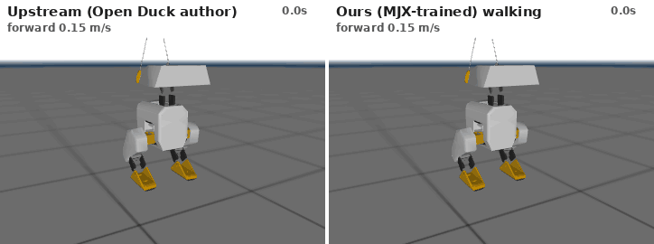
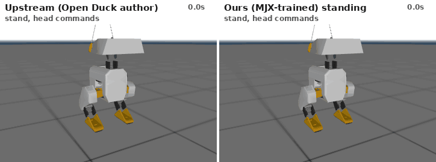
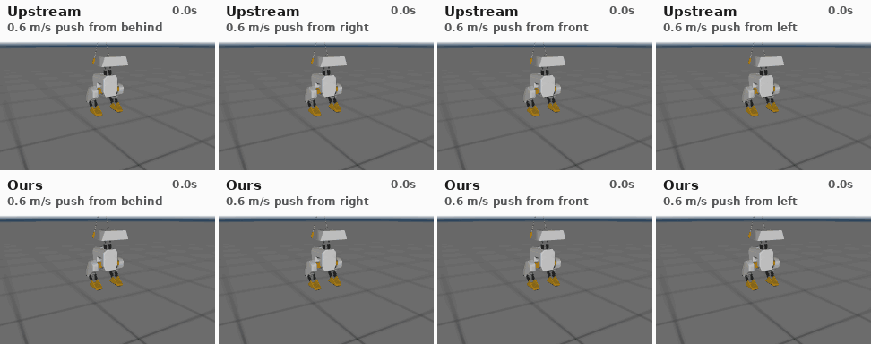

# BipedRL: sim-to-real RL locomotion for the Open Duck Mini v2

Reinforcement-learning locomotion for a small, self-built bipedal robot, the
[Open Duck Mini v2](https://github.com/apirrone/Open_Duck_Mini) (14 Feetech STS3215 servos, ~2.1 kg, ~42 cm).
The project covers GPU-parallel training in MuJoCo MJX, cross-simulator validation, and a single
controller runtime shared by simulation and the real robot.

<p align="center"></p>

**What's here**

- **GPU training pipeline:** MJX + Brax PPO, about 93k env steps/s on one RTX 4070 SUPER. A 150M-step walking policy trains in about 33 min; the CPU pipeline takes about 15 h.
- **One controller contract for every backend:** observation, action and reward code is array-library generic. The GPU env (JAX), the CPU env (numpy) and the hardware runtime run *the same functions*, with parity tests between them.
- **Cross-simulator validation:** every policy trained in MJX is exported to ONNX (checked against Brax inference to about 1e-7) and evaluated in CPU MuJoCo. It also goes through the deployment loop with safety monitoring.
- **Audit of the upstream training setup:** nine findings, eight of them fixed, e.g. randomizations that were silently inert, and resets that started the feet inside the floor. See [docs/platform_selection.md](docs/platform_selection.md#gaps-found-while-integrating-upstream-relevant-to-sim-to-real).
- **Benchmarks:** velocity tracking over 9 commands, randomized robustness, and push recovery vs. magnitude and direction.

## Upstream vs. ours

"Upstream" is `BEST_WALK_ONNX.onnx`, the walking policy published by the Open Duck Mini author
(uploaded 2025-04-02). Both policies run in the same simulator, with identical commands and pushes.
Upstream publishes no separate standing policy, so the standing comparison uses its walking policy
at zero velocity command.

| Standing with head motion | Push recovery (0.6 m/s, four directions) |
|---|---|
|  |  |

### Results (CPU MuJoCo, nominal model)

Velocity tracking, mean RMS error over 9 commands (15 s episodes):

| policy | falls | vx err (m/s) | vy err (m/s) | yaw-rate err (rad/s) |
|---|---|---|---|---|
| upstream | 0 % | 0.03 | 0.08 | 0.12 |
| ours v3 (upstream reward) | 0 % | 0.04 | 0.07 | **0.11** |
| ours v4 (2× velocity tracking) | 0 % | **0.03** | 0.07 | 0.24 |

Push recovery: success rate for a single planar kick in 8 directions:

| push (m/s) | 0.2 | 0.4 | 0.6 | 0.8 | 1.0 |
|---|---|---|---|---|---|
| upstream | 1.00 | 0.88 | 0.75 | 0.62 | 0.12 |
| ours v4 | 1.00 | 0.88 | 0.62 | 0.25 | 0.00 |
| ours, standing policy | 1.00 | 0.88 | 0.50 | 0.38 | 0.00 |

What we've learned so far:

- Our policies match upstream on nominal tracking but are **not yet more push-robust**. Their failures cluster on pushes from behind.
- v1–v3 had a deadzone: they stood still for commands of 0.1 m/s or less. Doubling the tracking weight (v4) fixed that but introduced yaw drift.
- Removing upstream's lateral velocity tolerance hurt forward walking. The tolerance absorbs natural gait sway, so it isn't a bug.
- Running MJX-trained policies in CPU MuJoCo showed a 15 % nominal fall rate. The cause wasn't a physics gap: resets started the feet inside the floor. Fixing the reset brought it to 0 %.

These are single-seed results. Raw numbers are in `results/*/eval_*.json` and `results/*/push_*.json`;
training curves are in `results/*/progress.jsonl`.

### How our training differs from upstream's

Same algorithm and budget: Brax PPO, 8192 envs, 150M steps, upstream hyperparameters, upstream
reward terms (v3), imitation of the same reference gaits, same observation/action interface. The
environment differs on purpose:

| | upstream (Open_Duck_Playground) | ours |
|---|---|---|
| episode reset | cached first state; controller history carries over | full re-randomized reset |
| initial pose | joints ×[0.5, 1.5], base height fixed (feet can start in the floor) | joints ×[0.8, 1.2], lower foot placed on the ground |
| IMU latency | applied to an unused signal (inert) | applied to gyro + accelerometer |
| servo calibration offsets | perturbs `qpos0` (inert for hinges) | ±0.03 rad applied to command and measurement |
| trunk mass/CoM randomization | applied to the massless root body | applied to the trunk |
| damping, torque-limit randomization | none | ±20 %, ±10 % |
| action history / head commands / rate limit | differ between training and the robot runtime | identical by construction |

Our environment is therefore harder, and closer to what the robot will see. The upstream
policy's name suggests it was the *best* of many tuning runs (the upstream history shows weeks of
iteration). Ours is a single seed per variant. Both factors plausibly explain the push-robustness
gap; separating them needs multi-seed runs and an "upstream-equivalent" ablation of our env.

## Quickstart

```bash
uv venv --python 3.10 .venv && VIRTUAL_ENV=.venv uv pip install -e ".[dev,gpu]"
scripts/fetch_upstream.sh                     # upstream repos at pinned commits (baseline policies)
env -u LD_LIBRARY_PATH JAX_PLATFORMS=cpu .venv/bin/python -m pytest -q    # 35 tests

# Train on GPU, then auto-export to ONNX and validate in CPU MuJoCo
env -u LD_LIBRARY_PATH .venv/bin/python scripts/train_mjx.py --config configs/train_walking.yaml \
    --run results/my_walking --set rewards.scales.tracking_lin_vel=5.0

# Evaluate / compare / visualize
.venv/bin/python scripts/evaluate.py --policy results/my_walking/policy.onnx --out results/my_walking/eval.json
.venv/bin/python scripts/push_recovery.py --policy results/my_walking/policy.onnx
.venv/bin/python scripts/make_gifs.py --ours-walk results/my_walking/policy.onnx
.venv/bin/python scripts/visualize.py joints --fixed-base     # manual joint sliders

# Deployment rehearsal: policy -> RobotInterface loop with safety checks
.venv/bin/python scripts/deploy.py --policy results/my_walking/policy.onnx --cmd 0.1 0 0
```

`env -u LD_LIBRARY_PATH` stops a system CUDA install from shadowing the CUDA libraries JAX
installs. A CPU-only SB3 pipeline (`scripts/train.py`) is also included for machines without a GPU.

## Interface contract

- **Observation (101-D)**: gyro, accelerometer, command (vx, vy, wz plus 4 head angles), joint
  positions relative to home, scaled joint velocities, last 3 actions, motor targets, foot
  contacts, gait phase. Only quantities available on the robot; the critic additionally gets
  privileged state during training.
- **Action (14-D)**: joint target = home + 0.25·a, rate-limited to 5.24 rad/s and clipped to 95 % of
  the joint range; head joints add the commanded head angles.
- 50 Hz control, 500 Hz physics. ONNX: `obs[1,101] → continuous_actions[1,14]`, the same
  interface as the upstream policies, so policies also run on the upstream Raspberry Pi runtime.

## Layout

```text
configs/robot.yaml             joint order, servo IDs, limits, home pose, actuator params, pinned upstream commits
configs/train_*.yaml           task, noise, latency, pushes, rewards, PPO settings (CPU and GPU)
configs/randomization.yaml     domain randomization ranges
assets/open_duck_mini_v2/      upstream MJCF + meshes (unmodified, Apache-2.0), reference gaits
biped/control/                 observation, action, gait phase, safety, PolicyRuntime (shared sim/hardware)
biped/envs/                    CPU MuJoCo gymnasium env, rewards, domain randomization
biped/mjx/                     GPU (JAX/MJX) env, batched randomization, ONNX export
biped/hardware/                RobotInterface, MuJoCo backend, servo calibration transforms
biped/evaluation/              rollout metrics
scripts/                       train_mjx, train (CPU), evaluate(_mjx), push_recovery, compare, make_gifs,
                               visualize, deploy, calibrate_actuators, export_onnx
tests/                         model/joint-sign checks, contract, env, CPU↔MJX parity
```

## Roadmap

| Milestone | Status |
|---|---|
| M0 platform selection | Open Duck Mini v2 locked ([decision record](docs/platform_selection.md)); price re-check and 2-servo bench test pending |
| M1 simulation foundation | done |
| M2 standing | done in sim: 0 % falls with randomization, noise and latency |
| M3 walking | matches upstream nominal tracking; next: yaw fix, push curriculum, multi-seed |
| M4 hardware characterization | build robot, calibrate joints, identify servo response |
| M5–M6 tethered → free walking | deploy through `scripts/deploy.py` hardware backend |
| M7 write-up | sim-to-real ablation: nominal vs. calibrated dynamics, with/without randomization |

## Acknowledgements

The robot design, MJCF model, reference gaits and baseline policies come from the
[Open Duck Mini](https://github.com/apirrone/Open_Duck_Mini) project by Antoine Pirrone and
contributors (Apache-2.0); the actuator model was identified with Rhoban's
[BAM](https://github.com/Rhoban/bam). Built on MuJoCo/MJX, MuJoCo Playground and Brax.
